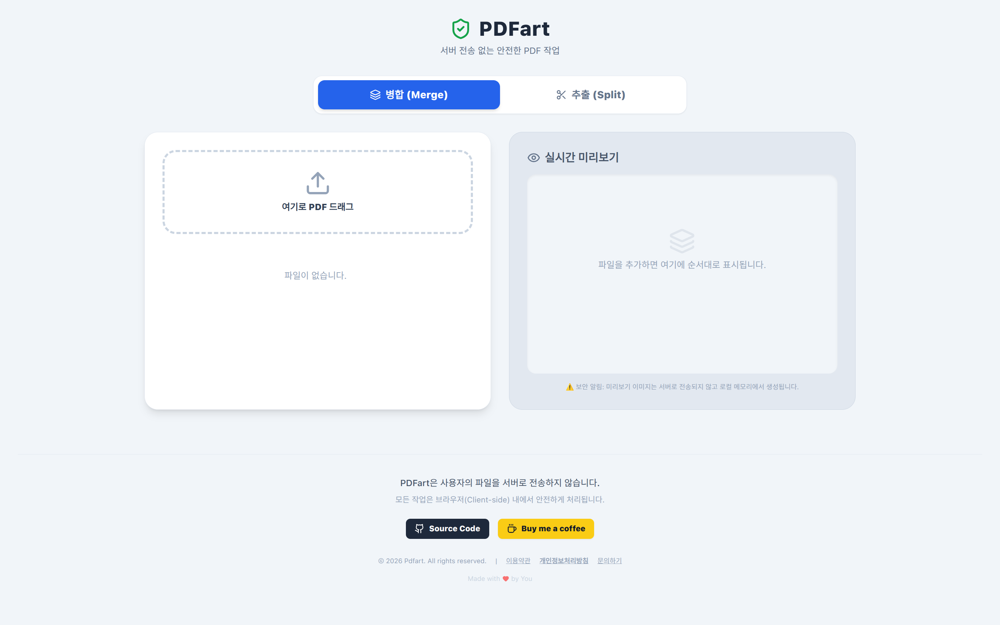

<div align="center">

[](./README.md)
[](./README.ko.md)

# 🛡️ Pdfart (Private PDF Tool)

> **"Your files never leave your browser."**
>
> **Pdfart** is a Private PDF tool that runs 100% within your browser (Client-side), ensuring your files are never sent to a server.


</div>

---

## 📸 Preview



## ✨ Key Features

### 1. 🔒 Privacy First
- **Serverless:** No backend server. All operations are processed in your PC memory using WebAssembly and JavaScript.
- **No Uploads:** Your sensitive data (passports, contracts) is never at risk of leakage.

### 2. 📑 PDF Merge
- **Drag & Drop:** Easily add multiple PDF files.
- **Reorder:** Intuitively change the merge order by dragging the file list.
- **Live Preview:** Instantly check file covers in the right panel.

### 3. ✂️ Split Pages
- **Select Pages:** Extract specific pages and save them as a new PDF.
- **Click-to-Add:** Click page images in the preview to automatically add page numbers.
- **Range Support:** Supports flexible inputs like `1, 3, 5-10`.

### 4. 🚀 Modern Web Tech
- **Fast:** Instant reaction speed based on React + Vite.
- **Clean UI:** Modern and intuitive design using Tailwind CSS.

---

## 🛠️ Tech Stack

This project is built using the following open-source libraries:

- **Frontend Framework:** [React](https://react.dev/) + [Vite](https://vitejs.dev/)
- **Styling:** [Tailwind CSS](https://tailwindcss.com/)
- **PDF Core Logic:** [pdf-lib](https://pdf-lib.js.org/) (Creation & Modification)
- **PDF Rendering:** [pdfjs-dist](https://github.com/mozilla/pdf.js) (Preview Generation)
- **Icons:** [Lucide React](https://lucide.dev/)
- **Drag & Drop:** Native HTML5 Drag and Drop API

---

## 🚀 Getting Started

Use Node.js 24 to match the CI environment.

```bash
# 1. Clone Repository
git clone [https://github.com/nyongcho/pdfart.git](https://github.com/nyongcho/pdfart.git)
cd pdfart

# 2. Install Dependencies
npm install

# 3. Run Dev Server
npm run dev
```

## Checks and CI

```bash
npm ci
npm run lint
npm test
npm run build
```

GitHub Actions runs these checks on pull requests and pushes to `master` and `dev`.
Vercel deployment is unchanged; this workflow does not configure deployment
gates or required PR checks.

Tests use Node's built-in test runner and real PDFs generated in memory.
They cover merge order, page extraction, duplicate selections, invalid input,
and large page ranges. Page selections use decimal whole numbers, are deduplicated
and sorted in document order, and ranges are clipped to existing pages. Invalid
tokens are ignored; a selection with no valid pages raises an error.
